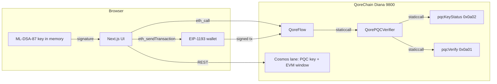
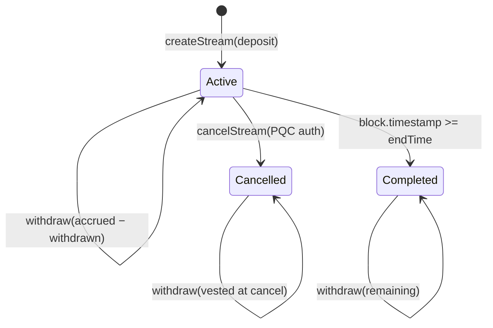
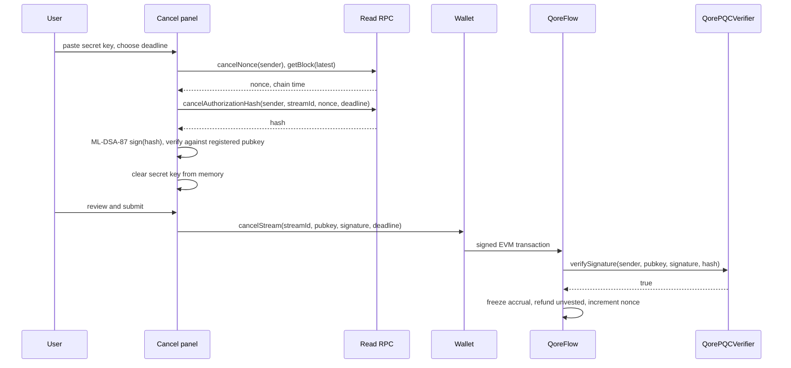

# Architecture

## 1. System overview

QoreFlow has three layers:

1. **Contracts** on QoreChain Diana (EVM chain 9800): stream accounting and the post-quantum authorization gate.
2. **Chain services**: the `pqcVerify` and `pqcKeyStatus` precompiles, the Cosmos-lane key registration and EVM authorization windows.
3. **Frontend**: a Next.js App Router application that reads through a public RPC, signs with an EIP-1193 wallet, and computes live accrual locally for display.



## 2. Contracts

### 2.1 `QoreFlow`

State:

```solidity
struct Stream {
    address sender;
    address recipient;
    uint256 deposit;
    uint64 startTime;
    uint64 endTime;
    uint64 cancelledAt;
    uint256 withdrawn;
    bool cancelled;
}
```

Invariants:

- `withdrawn <= accrued <= deposit` for every stream.
- Contract balance equals `Σ(deposit − withdrawn − refunded)` for all streams.
- `cancelledAt == 0` iff `!cancelled`.
- `nextStreamId` only increases.

Lifecycle:



Accrual:

```
effectiveNow = cancelled ? cancelledAt : block.timestamp
elapsed      = clamp(effectiveNow − startTime, 0, duration)
accrued      = min(deposit, floor(deposit × elapsed / duration))
withdrawable = accrued − withdrawn
```

`Math.mulDiv` prevents overflow on `deposit × elapsed`.

### 2.2 `QorePQCVerifier`

Responsibilities:

- Read the registered key via `pqcKeyStatus`.
- Enforce `registered`, `algorithmId == 1`, `possessionProven`, and exact key equality.
- Enforce ML-DSA-87 lengths (2592-byte public key, 4627-byte signature).
- Call `pqcVerify` and reject empty returns.
- Never expose an owner or setter: wiring is immutable.

The precompile addresses are constructor arguments so the local suite can inject clearly-labelled doubles. The canonical constants are public and asserted by deployment and verification scripts.

### 2.3 Cancellation authorization

```
domain  = keccak256(EIP712Domain("QoreFlow","1",chainid,address(this)))
action  = keccak256("QOREFLOW_CANCEL_STREAM_V1")
message = keccak256(abi.encode(
            domain,
            keccak256("CancelStream(address sender,uint256 streamId,bytes32 action,uint256 nonce,uint256 deadline)"),
            sender, streamId, action, nonce, deadline))

signature = ML-DSA-87.sign(secretKey, message)   // 4627 bytes
```

`cancelAuthorizationHash` is a public view, so the frontend and tests never re-implement the encoding. The contract uses the same 32 bytes as the precompile message.

## 3. Frontend

### 3.1 Routes

| Route | Rendering | Purpose |
| --- | --- | --- |
| `/` | static | Landing page: product, security model, FAQ |
| `/dashboard` | client | Incoming/outgoing streams, live stats, activity |
| `/streams/create` | client | RHF + Zod creation form |
| `/streams/[id]` | server shell + client detail | Single stream, withdraw, PQC cancel |
| `/security` | client | Verified / wallet-reported / unknown signals |

### 3.2 Data flow

- **Reads** use a singleton `JsonRpcProvider` (`lib/blockchain/provider.ts`) against `NEXT_PUBLIC_QORECHAIN_RPC`.
- **Writes** use `BrowserProvider.getSigner()` from the user's wallet. The app never holds a private key.
- **TanStack Query** keys: `streams`, `stream`, `activity`, `pqc-key-status`, `evm-window`. Mutations invalidate the relevant keys.
- **Event indexing** scans `StreamCreated`, `StreamWithdrawn`, `StreamCancelled` in 50k-block chunks from `NEXT_PUBLIC_DEPLOY_BLOCK` (or a bounded fallback).
- **Live accrual** is recomputed every second from timestamps; the chain is re-read every 15 seconds.

### 3.3 Signing flow



### 3.4 UI trust tiers

| Tier | Examples | Rendering |
| --- | --- | --- |
| Verified on chain | `pqcKeyStatus` fields, stream state, accrual | Green/primary, explicit values |
| Wallet-reported | address, chain id, injected provider | Amber "wallet-reported" |
| Unknown | REST window failure, precompile read failure | Amber "unknown", never green |

The UI never derives "quantum secure" from a wallet connection.

## 4. Key design decisions

1. **PQ authorization only for cancellation.** Withdrawal is recipient-only and cannot overpay. Applying the expensive check to the one destructive sender action keeps gas and UX reasonable.
2. **Key binding is mandatory.** `pqcVerify` alone proves "some key signed"; it does not prove account ownership. `QorePQCVerifier` requires the registered key and proof of possession.
3. **No classical fallback.** If the key or precompile cannot be verified, cancellation is disabled. A fallback would defeat the category's purpose.
4. **Contract-owned encoding.** The frontend asks the contract for the hash instead of rebuilding it, eliminating drift.
5. **Immutable wiring.** Precompile addresses are constructor arguments with no setter; deployment scripts assert the canonical values.
6. **Honest UI.** Three trust tiers, raw REST payload visible, explicit "what this page does not claim" section.

## 5. Failure handling

- **Inactive precompile** → `PrecompileReturnedNoData`, fail closed.
- **Wrong key** → `SuppliedKeyDoesNotMatchRegistration`, before `pqcVerify`.
- **Expired authorization** → `AuthorizationExpired`, before verification.
- **Replay** → nonce mismatch → `InvalidPostQuantumSignature`.
- **Window exhausted** → chain refusal code 27; the UI surfaces the REST bounds when available.
- **Wallet rejection** → toast with "rejected in your wallet", no state change.

## 6. File map

```
contracts/QoreFlow.sol
contracts/security/IQorePQC.sol
contracts/security/QorePQCVerifier.sol
contracts/test/MockQorePrecompiles.sol     test doubles only
contracts/test/TestRecipients.sol          test doubles only

test/helpers/setup.ts                      fixture + hash builder
test/QoreFlow.test.ts                      lifecycle + reentrancy
test/PQCAuthorization.test.ts              PQC positive/negative
test/invariants/Accounting.test.ts         randomized accounting
test/testnet/PQC.testnet.ts                real chain, read-only

lib/config.ts                              chain + PQC constants
lib/contracts/qoreflow.ts                  ABI + factories
lib/blockchain/streams.ts                  events, accrual, status
lib/blockchain/errors.ts                   custom-error copy
lib/pqc/signer.ts                          keygen/import/sign/verify
lib/pqc/status.ts                          key status + window parser + usability rules
lib/qorechain/address.ts                   0x → qor1 bech32 conversion

hooks/useWallet.tsx                        EIP-1193 session
hooks/useStreams.ts                        query hooks
hooks/usePqc.ts                            PQC status + window hooks
hooks/useNow.ts                            one-second clock

app/                                       routes
app/api/evm-window/route.ts                same-origin REST proxy (0x → bech32)
components/                                UI, wallet, streams, security
scripts/deploy.ts                          guarded deployment
scripts/verify-deployment.ts               read-only verification
```
